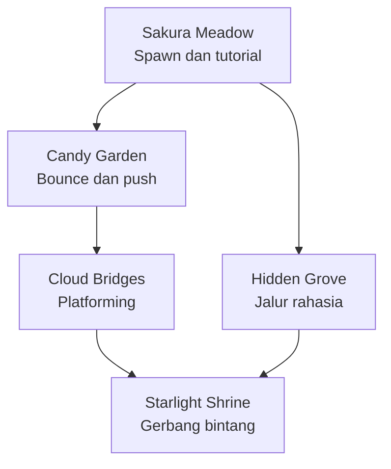
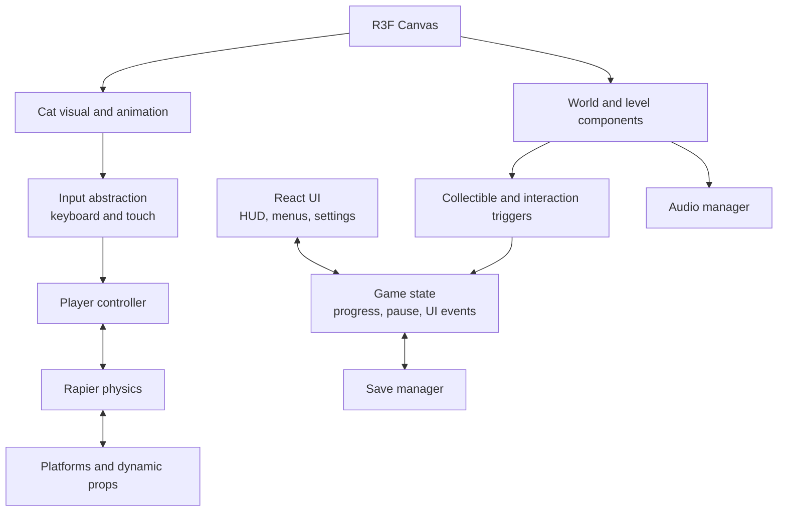

# Xeranov Dreamland
## Dokumen Perencanaan Proyek — v1.0

**Domain:** `xeranov.com`  
**Jenis proyek:** Game eksplorasi 3D interaktif di browser  
**Target platform:** Desktop dan mobile browser  
**Bahasa implementasi:** TypeScript  
**Stack utama:** Vite, React, Three.js, React Three Fiber, Rapier, Drei, Blender  
**Backend MVP:** Tidak diperlukan  
**AI API:** Tidak digunakan

> **Visi:** Membuat dunia game 3D kawaii yang bisa dimainkan langsung di browser. Pemain mengendalikan seekor kucing bergaya mainan vinyl yang menjelajahi pulau terapung, taman sakura, jembatan awan, dan area rahasia. Fokus utama adalah eksplorasi, kontrol yang menyenangkan, collectible, puzzle ringan, dan kejutan tersembunyi—bukan portofolio konvensional.

---

## 1. Ringkasan konsep

Xeranov Dreamland terinspirasi oleh pengalaman eksplorasi 3D interaktif dan kontrol kendaraan dari situs Bruno Simon, tetapi harus memiliki identitas, mekanik, level design, model, suara, dan visual orisinal. Jangan menyalin aset, layout, atau desain spesifik situs referensi.

### Pilar desain

1. **Play first:** pemain dapat mulai bergerak segera setelah dunia siap.
2. **Hybrid movement:** kontrol platformer presisi dipadukan dengan interaksi fisika lucu.
3. **Curiosity rewards:** jalur samping, collectible, puzzle, dan easter egg mendorong eksplorasi.
4. **Kawaii toy world:** lingkungan pastel low-poly berpadu dengan kucing 3D halus seperti mainan vinyl glossy.
5. **Browser-friendly:** loading bertahap, kontrol mobile, pengaturan kualitas, dan tanpa instalasi.
6. **No paid AI dependency:** gameplay dan konten menggunakan kode lokal, aset buatan sendiri, dan konfigurasi statis.

### Pengalaman pemain

1. Membuka `xeranov.com`.
2. Melihat layar pembuka dan tombol **Play**.
3. Mengendalikan kucing di Sakura Meadow.
4. Mempelajari gerak, melompat, dash, dan berinteraksi.
5. Mengumpulkan Star Fragments dan Hidden Bells.
6. Membuka jalur baru, aksesori, achievement, serta Starlight Shrine.
7. Menemukan rahasia dan menyelesaikan tantangan opsional.

---

## 2. Art direction

### Palet awal

Gunakan nilai berikut sebagai token awal; sesuaikan setelah prototipe visual dibuat.

| Token | Warna | Penggunaan |
|---|---|---|
| `dream-pink` | `#F6A9D2` | Aksen utama, bunga, UI |
| `soft-rose` | `#E887B7` | Hover, tombol aktif |
| `cloud-cream` | `#FFF4F8` | Awan dan permukaan terang |
| `lavender` | `#C9B8FF` | Kristal dan area magis |
| `mint` | `#BFEBD8` | Rumput dan aksen alam |
| `sky-blue` | `#B9E5FF` | Langit dan air |
| `plum-ink` | `#49354F` | Teks UI dan kontras |

### Karakter kucing

- Siluet mudah dikenali dari jauh.
- Proporsi chibi: kepala besar, badan mungil, kaki pendek.
- Material seperti vinyl: halus, sedikit glossy, tetapi tidak terlalu reflektif.
- Warna dasar putih hangat atau krem dengan aksen telinga dan telapak kaki pink.
- Mata ekspresif dan animasi telinga/ekor.
- Ekspor model dalam format `.glb`.
- Animasi minimum: `Idle`, `Walk`, `Run`, `Jump`, `Fall`, `Land`, `Dash`, `Interact`, `Meow`.

### Lingkungan

- Pulau terapung dengan bentuk sederhana dan siluet jelas.
- Sakura, bunga besar, jamur elastis, rumah mini, kristal, awan, jembatan pelangi.
- Lingkungan boleh low-poly untuk menjaga performa; karakter menjadi fokus visual yang lebih halus.
- Hindari terlalu banyak objek berkilau, bayangan dinamis, atau partikel yang mengganggu keterbacaan jalur.

---

## 3. Dunia dan level design

Mulai dengan satu area yang kecil tetapi selesai dan menyenangkan. Tambahkan area lain setelah core gameplay stabil.

### Zone A — Sakura Meadow

**Fungsi:** spawn area, tutorial, dan hub utama.

Konten:
- Area spawn aman.
- Papan tutorial.
- Pohon sakura, rumput pastel, rumah kecil, dan awan latar.
- Star Fragments pertama.
- Checkpoint awal.
- Jalur menuju Candy Garden dan jalur rahasia yang bisa ditemukan belakangan.

### Zone B — Candy Garden

**Fungsi:** memperkenalkan interaksi fisika.

Konten:
- Jamur yang memantulkan pemain.
- Kotak dan bola yang dapat didorong.
- Bunga besar dan dekorasi candy.
- Platform kecil untuk latihan lompatan.
- Collectible yang membutuhkan penggunaan bounce.

### Zone C — Cloud Bridges

**Fungsi:** tantangan platforming.

Konten:
- Jembatan awan dan platform terapung.
- Lompatan jarak sedang.
- Platform bergerak jika performa dan waktu memungkinkan.
- Checkpoint sebelum rangkaian lompatan yang sulit.
- Collectible opsional untuk pemain yang mahir.

### Zone D — Starlight Shrine

**Fungsi:** hadiah eksplorasi dan tantangan akhir awal.

Konten:
- Gerbang yang membutuhkan sejumlah Star Fragments.
- Puzzle sederhana berbasis urutan atau aktivasi objek.
- Kristal bercahaya dan dekorasi malam.
- Hidden Bell atau aksesori spesial.
- Secret ending setelah kondisi tertentu terpenuhi.

### Zone opsional — Hidden Grove

- Area tersembunyi di balik pohon atau tebing.
- Ditemukan dengan eksplorasi, bukan instruksi langsung.
- Berisi collectible langka, easter egg, atau dekorasi khusus.

### Alur level



Gerbang utama dapat meminta sejumlah bintang, tetapi pemain boleh menemukan area rahasia lebih awal jika mampu mencapainya.

---

## 4. Core gameplay dan progression

### Gameplay loop

**Explore → Discover → Collect → Unlock → Customize → Explore further**

1. Jelajahi pulau dan cari jalur alternatif.
2. Temukan Star Fragments, Hidden Bells, dan puzzle.
3. Kumpulkan reward dan catat progres.
4. Buka gerbang atau aksesori.
5. Kembali ke area sebelumnya dengan kemampuan baru.
6. Temukan rahasia yang sebelumnya tidak dapat dijangkau.

### Target konten awal (dapat diubah melalui konfigurasi)

- 30 Star Fragments.
- 8 Hidden Bells.
- 3 aksesori kucing.
- 5 achievement.
- 1 puzzle shrine dan 1 secret ending.
- 3 checkpoint di luar checkpoint awal.

Angka di atas adalah target konten, bukan persyaratan MVP pertama.

### Mekanik karakter

| Mekanik | Spesifikasi perilaku |
|---|---|
| Walk/run | Akselerasi responsif dan kecepatan maksimum yang dapat dikonfigurasi |
| Jump | Lompatan presisi dengan buffer dan coyote time |
| Air control | Kontrol arah di udara terbatas tetapi dapat diprediksi |
| Double jump | Kemampuan unlock opsional setelah MVP |
| Dash | Dorongan singkat dengan cooldown; dapat dipakai di darat dan/atau udara sesuai balancing |
| Bounce | Jamur atau platform memberi impuls vertikal |
| Push | Mendorong objek ringan yang menggunakan rigid body |
| Interact | Interaksi berdasarkan jarak dan input pemain |
| Meow | Animasi/efek suara lucu, tidak wajib untuk progres |
| Fall recovery | Respawn pada checkpoint jika jatuh keluar area permainan |

### Prinsip balancing

- Pemain harus bisa menghentikan gerakan secara wajar.
- Jangan mengandalkan fisika mentah untuk gerak utama karakter.
- Gunakan controller karakter yang mengatur kecepatan dan lompatan secara eksplisit.
- Gunakan Rapier untuk grounding, collision, objek dinamis, bounce, dan interaksi lingkungan.
- Hindari lompatan yang membutuhkan presisi ekstrem.
- Sediakan checkpoint sebelum tantangan yang lebih sulit.

### Collectible

Collectible menggunakan trigger collider, bukan collider padat yang menghalangi pemain.

Saat diambil:
1. Validasi bahwa item belum dikumpulkan.
2. Mainkan animasi pickup dan efek partikel.
3. Tambahkan item ke progres lokal.
4. Perbarui HUD.
5. Simpan progres dengan mekanisme save yang tidak menulis ke `localStorage` setiap frame.

---

## 5. Stack teknologi

| Teknologi | Peran |
|---|---|
| Vite | Development server dan build produksi |
| React + TypeScript | UI, lifecycle aplikasi, menu, dan komponen |
| Three.js | Rendering WebGL, material, kamera, lighting |
| React Three Fiber | Integrasi scene Three.js dengan React |
| `@react-three/drei` | Helper model GLB, animasi, kamera, loading, dan utilitas scene |
| Rapier melalui `@react-three/rapier` | Fisika, rigid body, collider, collision events |
| Blender | Pembuatan model dan animasi 3D |
| GLB/glTF | Format distribusi model 3D |
| `localStorage` | Save progres lokal untuk MVP |
| Cloudflare Pages | Hosting statis untuk build Vite |

### Aturan arsitektur

- Gunakan TypeScript dan aktifkan pemeriksaan tipe yang ketat.
- Pilih versi paket yang kompatibel, lalu commit lockfile.
- Jangan menggabungkan beberapa physics engine.
- Jangan memindahkan seluruh posisi karakter ke React state setiap frame.
- Gunakan refs atau state internal game untuk data berfrekuensi tinggi.
- React state digunakan untuk UI yang perlu bereaksi terhadap perubahan seperti jumlah bintang, dialog, menu, dan status pause.
- Definisikan data level, collectible, dan reward dalam konfigurasi, bukan hardcode tersebar.
- Tidak ada backend atau AI API untuk MVP.

---

## 6. Arsitektur runtime



### Aliran tanggung jawab

1. Input abstraction menerima input keyboard, mouse, dan touch.
2. Player controller mengubah input menjadi gerakan karakter.
3. Physics engine menyelesaikan tabrakan dan interaksi objek.
4. Animation system memilih animasi sesuai keadaan karakter.
5. Interaction/collectible system mengirim event ketika pemain berada di dekat objek atau mengambil item.
6. Game state menyimpan data progres yang dibutuhkan UI.
7. Save manager menyimpan perubahan progres yang relevan.
8. UI menampilkan HUD, dialog, menu, dan pengaturan.

---

## 7. Struktur folder

```text
xeranov-dreamland/
├── public/
│   ├── models/
│   │   ├── characters/
│   │   │   └── cat.glb
│   │   ├── environment/
│   │   ├── props/
│   │   └── collectibles/
│   ├── textures/
│   ├── audio/
│   └── fonts/
├── src/
│   ├── app/
│   │   ├── App.tsx
│   │   └── GameCanvas.tsx
│   ├── game/
│   │   ├── config/
│   │   │   ├── game.config.ts
│   │   │   ├── world.config.ts
│   │   │   └── controls.config.ts
│   │   ├── player/
│   │   │   ├── CatCharacter.tsx
│   │   │   ├── PlayerController.ts
│   │   │   ├── PlayerPhysics.tsx
│   │   │   └── PlayerAnimations.ts
│   │   ├── camera/
│   │   │   └── CameraController.tsx
│   │   ├── world/
│   │   │   ├── WorldRoot.tsx
│   │   │   ├── islands/
│   │   │   ├── environment/
│   │   │   └── zones/
│   │   ├── systems/
│   │   │   ├── InteractionSystem.ts
│   │   │   ├── CollectibleSystem.ts
│   │   │   ├── CheckpointSystem.ts
│   │   │   ├── SaveManager.ts
│   │   │   └── AudioManager.ts
│   │   └── objects/
│   │       ├── Collectible.tsx
│   │       ├── BounceMushroom.tsx
│   │       └── InteractiveObject.tsx
│   ├── ui/
│   │   ├── HUD.tsx
│   │   ├── MainMenu.tsx
│   │   ├── PauseMenu.tsx
│   │   ├── SettingsPanel.tsx
│   │   ├── InventoryPanel.tsx
│   │   └── MobileControls.tsx
│   ├── hooks/
│   │   └── useGameInput.ts
│   ├── styles/
│   │   └── global.css
│   └── main.tsx
├── index.html
├── package.json
├── tsconfig.json
└── vite.config.ts
```

Struktur ini adalah target arsitektur, bukan keharusan membuat semua file sekaligus. Buat file ketika milestone memerlukannya. Hindari file kosong yang hanya menjadi placeholder.

---

## 8. Spesifikasi kontrol

### Desktop

| Input | Aksi |
|---|---|
| `W`, `A`, `S`, `D` | Bergerak relatif terhadap orientasi kamera |
| Arrow keys | Alternatif gerak |
| `Space` | Jump |
| `Shift` | Dash |
| `E` | Interact |
| Mouse drag | Putar kamera manual |
| Scroll | Zoom kamera dengan batas |
| `Esc` | Pause / tutup panel aktif |

### Mobile

- Virtual joystick di kiri bawah untuk bergerak.
- Area drag di sisi kanan layar untuk memutar kamera.
- Tombol Jump, Dash, dan Interact di kanan bawah.
- Tombol harus nyaman disentuh dan tidak menutupi karakter.
- Sediakan pengaturan sensitivitas kamera.
- Cegah gesture game memicu scroll halaman secara tidak sengaja, tetapi tetap biarkan menu dan panel UI dapat digunakan.
- Pastikan pemain dapat menjangkau seluruh kontrol dengan ibu jari.

### Implementasi input

Gunakan satu input abstraction untuk semua perangkat. Keyboard dan touch harus menghasilkan input gameplay yang sama agar controller dan fisika tidak perlu diduplikasi.

---

## 9. Player controller dan kamera

### Hybrid movement

Gunakan gerakan platformer yang presisi untuk lokomosi utama, dengan interaksi fisika untuk lingkungan.

**Karakter:**
- Capsule collider untuk grounding dan collision.
- Visual model terpisah dari collider.
- Gerakan horizontal berbasis kecepatan target dan akselerasi terkontrol.
- Lompatan berbasis impulse atau kecepatan vertikal yang dikontrol.
- Air control terbatas.
- Coyote time dan jump buffering untuk kontrol yang lebih ramah.
- State machine untuk `Idle`, `Move`, `Jump`, `Fall`, `Land`, `Dash`, dan `Interact`.

**Lingkungan:**
- Static colliders untuk tanah dan pulau.
- Trigger colliders untuk collectible dan zona interaksi.
- Dynamic rigid bodies untuk kotak dan bola yang dapat didorong.
- Bounce pad memberi impuls yang dapat dikonfigurasi.
- Respawn jika karakter melewati batas jatuh dunia.

### Kamera

Mode default adalah third-person follow dengan rotasi manual.

- Mengikuti karakter dengan smoothing.
- Memiliki batas pitch dan jarak.
- Menghindari clipping terhadap objek penting bila memungkinkan.
- Menyesuaikan jarak dan framing untuk layar portrait.
- Tidak mengubah orientasi input secara mendadak ketika kamera diputar.
- Memiliki opsi sensitivitas dan camera shake.
- Camera shake dapat dikurangi atau dimatikan di pengaturan.

### Catatan fisika

Jangan membuat model kucing visual menjadi rigid body kompleks. Gunakan collider sederhana. Gerak karakter utama harus tetap bisa diprediksi; fisika dinamis terutama digunakan pada objek lingkungan dan efek bounce.

---

## 10. Model dan pipeline aset

### Pipeline Blender

1. Buat blockout model menggunakan bentuk sederhana.
2. Pastikan skala dan orientasi konsisten.
3. Buat material dengan jumlah yang wajar.
4. Buat armature dan animasi karakter.
5. Periksa origin/pivot dan transform.
6. Ekspor ke GLB.
7. Uji model di browser.
8. Optimalkan mesh, tekstur, dan animasi sebelum ditambahkan ke level.

### Standar aset

- Gunakan nama file yang deskriptif dan stabil.
- Gunakan satuan/skala konsisten.
- Hindari material duplikat yang tidak perlu.
- Pisahkan aset dekorasi statis dan objek interaktif.
- Gunakan collider sederhana yang terpisah dari mesh visual.
- Pastikan lisensi aset pihak ketiga mengizinkan penggunaan yang direncanakan.
- Simpan file sumber Blender di repositori atau backup terpisah; file GLB adalah hasil ekspor.

### Prioritas aset

1. Model kucing dan animasi inti.
2. Blockout pulau dan platform.
3. Collectible.
4. Pohon sakura, rumput, awan, dan bunga.
5. Rumah, jamur bounce, kristal, serta dekorasi.
6. Efek partikel dan audio.

---

## 11. UI/UX dan accessibility

UI menggunakan gaya kawaii pastel, tetapi tidak boleh menghalangi gameplay.

### UI minimum

- Loading screen dengan progress.
- Tombol Play dan Continue.
- HUD jumlah Star Fragments.
- Prompt Interact.
- Pause menu.
- Settings: volume, kualitas grafis, sensitivitas kamera, kontrol, reduced motion.
- Dialog untuk petunjuk atau puzzle.
- Notifikasi saat collectible ditemukan.
- Panel inventory untuk aksesori.

### Prinsip UI

- Gunakan kontras yang cukup untuk teks.
- Jangan mengandalkan warna saja untuk menyampaikan status.
- Sediakan ikon beserta label ketika fungsi belum jelas.
- Pastikan menu bisa digunakan dengan keyboard dan touch.
- Pause game ketika menu pause terbuka.
- Hormati preferensi reduced motion.
- Sediakan opsi mute dan kontrol volume.
- Pastikan efek visual tidak membuat jalur/platform sulit terlihat.

---

## 12. Audio dan feedback

Audio membantu dunia terasa hidup, tetapi tidak wajib untuk menguji gerak awal.

### Audio awal

- Musik ambient lembut.
- Langkah kaki.
- Jump dan landing.
- Collectible pickup.
- Bounce mushroom.
- Interaksi/meow.
- Unlock gerbang.

### Aturan

- Semua suara dapat dimute.
- Volume musik dan SFX terpisah.
- Hindari autoplay musik dengan suara sebelum ada interaksi pengguna, karena kebijakan browser dapat memblokirnya.
- Gunakan file audio yang terkompresi dan hindari memuat semua suara besar sekaligus.

---

## 13. Save system dan data lokal

MVP menggunakan `localStorage`, tanpa akun dan backend.

### Data save contoh

```json
{
  "version": 1,
  "collectedStarIds": [],
  "collectedBellIds": [],
  "unlockedAccessories": [],
  "equippedAccessory": null,
  "unlockedZones": ["sakura-meadow"],
  "checkpointId": "sakura-start",
  "settings": {
    "musicVolume": 0.7,
    "sfxVolume": 0.8,
    "quality": "auto",
    "reducedMotion": false
  }
}
```

### Aturan save

- Simpan hanya perubahan yang relevan, bukan setiap frame.
- Validasi data saat load; jangan mengasumsikan JSON selalu benar.
- Gunakan `version` agar format save dapat dimigrasikan.
- Sediakan tombol reset progres dengan konfirmasi.
- Jika save rusak, fallback ke data default.
- Beri tahu pemain bahwa progres disimpan pada browser/perangkat tersebut.
- Data lokal dapat hilang jika browser data dihapus; cloud save membutuhkan backend dan berada di luar MVP.

---

## 14. Strategi performa

Target berikut adalah sasaran pengembangan yang harus diuji, bukan jaminan universal.

| Area | Target awal |
|---|---|
| Desktop | 60 FPS pada perangkat yang memadai |
| Mobile | 30–60 FPS sesuai perangkat |
| Draw calls | Usahakan sekitar 150–200 atau kurang di area awal |
| Initial download | Target sekitar 5 MB atau kurang jika realistis untuk aset awal |
| Rendering | Gunakan pixel ratio adaptif |
| Physics | Collider sederhana dan jumlah rigid body dinamis terkendali |
| Loading | Tampilkan progress dan muat area awal dahulu |

### Teknik optimasi

- Gunakan `InstancedMesh` untuk bunga, rumput, dan dekorasi berulang.
- Gunakan GLB dan kompresi mesh/tekstur bila sesuai.
- Pertimbangkan KTX2 untuk tekstur terkompresi.
- Gunakan lighting baked untuk dekorasi statis.
- Batasi shadow dinamis.
- Terapkan lazy loading atau pemuatan bertahap untuk zona berikutnya.
- Gunakan collider sederhana.
- Hindari React state update setiap frame.
- Batasi partikel dan transparansi berlapis.
- Sediakan kualitas rendah, sedang, dan tinggi.
- Profiling menggunakan build produksi, bukan hanya dev server.

### Quality tiers

**Low**
- Shadow minimal atau mati.
- Jumlah partikel rendah.
- Render scale lebih rendah.
- Jarak dekorasi lebih pendek.

**Medium**
- Shadow terbatas.
- Partikel sedang.
- Jarak render seimbang.

**High**
- Shadow dan partikel lebih banyak.
- Render scale lebih tinggi jika perangkat mendukung.

Jangan mengandalkan deteksi perangkat saja. Sediakan pilihan manual dan, bila memungkinkan, sesuaikan kualitas berdasarkan performa aktual.

---

## 15. Roadmap implementasi

Urutan kerja berikut bersifat berurutan. Jangan memperluas dunia sebelum fondasi gameplay lolos pengujian.

### Milestone 0 — Project foundation

- [ ] Buat proyek Vite React TypeScript.
- [ ] Pasang Three.js, R3F, Drei, dan Rapier.
- [ ] Pastikan development server dan production build berjalan.
- [ ] Tambahkan struktur folder awal dan konfigurasi.
- [ ] Tetapkan konvensi koordinat, skala, linting, dan formatting.

**Definition of done:** aplikasi berjalan dan menampilkan scene 3D kosong tanpa error.

### Milestone 1 — Playable prototype

- [ ] Tambahkan lantai dan platform sederhana.
- [ ] Buat karakter sementara berbentuk kapsul.
- [ ] Implementasikan gerakan keyboard.
- [ ] Implementasikan jump dan grounded detection.
- [ ] Implementasikan kamera follow.
- [ ] Tambahkan rotasi kamera manual.
- [ ] Tambahkan batas jatuh dan respawn.
- [ ] Uji tabrakan tepi platform dan perubahan frame rate.

**Definition of done:** pemain bisa bergerak, melompat, mendarat, jatuh, respawn, dan memutar kamera tanpa kontrol terasa rusak.

### Milestone 2 — Vertical slice visual

- [ ] Buat atau integrasikan model kucing GLB.
- [ ] Tambahkan animasi Idle, Walk, Run, Jump, Fall, dan Land.
- [ ] Buat satu area Sakura Meadow.
- [ ] Tambahkan material glossy pada karakter.
- [ ] Tambahkan rumput, satu pohon sakura, awan, dan langit.
- [ ] Tambahkan satu Star Fragment.
- [ ] Tambahkan HUD dan loading state.

**Definition of done:** area kecil sudah tampak sesuai art direction dan dapat dimainkan dari awal sampai mengambil collectible.

### Milestone 3 — Gameplay MVP

- [ ] Tambahkan dash dan cooldown.
- [ ] Tambahkan coyote time dan jump buffering.
- [ ] Tambahkan interaksi berdasarkan jarak.
- [ ] Tambahkan objek yang bisa didorong.
- [ ] Tambahkan bounce mushroom.
- [ ] Tambahkan checkpoint dan respawn.
- [ ] Tambahkan save/load lokal.
- [ ] Tambahkan pause menu dan pengaturan audio.
- [ ] Uji save yang rusak dan reset progres.

**Definition of done:** sesi bermain singkat memiliki tujuan, reward, checkpoint, dan progres yang tetap ada setelah reload.

### Milestone 4 — Mobile support

- [ ] Buat virtual joystick.
- [ ] Buat tombol jump, dash, dan interact.
- [ ] Tambahkan rotasi kamera berbasis touch.
- [ ] Cegah gesture game mengganggu navigasi UI.
- [ ] Sesuaikan HUD untuk portrait dan landscape.
- [ ] Uji pada HP nyata, bukan hanya emulator.

**Definition of done:** pemain bisa menyelesaikan loop gameplay inti tanpa keyboard.

### Milestone 5 — World expansion

- [ ] Tambahkan Candy Garden.
- [ ] Tambahkan Cloud Bridges.
- [ ] Tambahkan Hidden Grove.
- [ ] Tambahkan Starlight Shrine.
- [ ] Tambahkan gerbang berbasis collectible.
- [ ] Tambahkan aksesori, achievement, dan puzzle.
- [ ] Tambahkan collectible sesuai target konten.

**Definition of done:** dunia memiliki jalur eksplorasi, tantangan yang bervariasi, dan reward yang terasa berarti.

### Milestone 6 — Polish and release

- [ ] Optimalkan model, tekstur, draw calls, dan shadow.
- [ ] Profiling FPS dan penggunaan memori.
- [ ] Tambahkan kualitas Low/Medium/High.
- [ ] Tambahkan reduced motion.
- [ ] Uji berbagai browser dan ukuran layar.
- [ ] Uji loading lambat dan kegagalan memuat aset.
- [ ] Build produksi dan deploy ke Cloudflare Pages.
- [ ] Hubungkan `xeranov.com`.
- [ ] Pastikan halaman error dan loading tidak membuat pemain terjebak.

**Definition of done:** build produksi dapat dimainkan, dapat dipulihkan setelah jatuh, memiliki kontrol desktop/mobile, dan berjalan dengan performa yang layak pada perangkat target.

---

## 16. Perkiraan jadwal

Estimasi kasar untuk satu developer yang sudah nyaman dengan React/TypeScript. Waktu pembuatan aset 3D, animasi, dan debugging dapat mengubah jadwal.

| Tahap | Estimasi kasar |
|---|---:|
| Fondasi dan playable prototype | 3–7 hari |
| Vertical slice visual | 4–10 hari |
| Gameplay MVP dan save | 5–10 hari |
| Kontrol mobile | 3–7 hari |
| Perluasan dunia | 1–3 minggu |
| Optimasi, QA, deployment | 3–7 hari |

**Rencana realistis:** buat prototype dahulu, lalu evaluasi setelah karakter bisa bergerak dan melompat. Jangan menganggap seluruh roadmap harus selesai dalam satu sprint.

---

## 17. Testing checklist

### Gameplay
- [ ] Karakter tidak menembus lantai.
- [ ] Lompatan konsisten pada frame rate berbeda.
- [ ] Jump tidak dapat dipicu berulang tanpa grounding kecuali kemampuan memang mengizinkannya.
- [ ] Dash tidak menyebabkan karakter menembus dinding.
- [ ] Bounce pad bekerja secara konsisten.
- [ ] Collectible tidak dapat dihitung dua kali.
- [ ] Respawn memindahkan karakter ke checkpoint valid.
- [ ] Pause benar-benar menghentikan gameplay yang relevan.

### Camera dan controls
- [ ] Kamera tidak terjebak di dalam objek.
- [ ] Input gerak tetap konsisten saat kamera diputar.
- [ ] Input keyboard tidak macet setelah tab browser kehilangan fokus.
- [ ] Touch joystick dapat kembali ke posisi netral.
- [ ] UI mobile tidak menghalangi gerakan penting.

### Save
- [ ] Collectible tetap tercatat setelah reload.
- [ ] Save yang invalid tidak membuat aplikasi crash.
- [ ] Reset progres bekerja setelah konfirmasi.
- [ ] Versi save dapat dikenali.
- [ ] Pengaturan audio dan kontrol tersimpan jika memang dirancang untuk disimpan.

### Performance
- [ ] Uji pada desktop kelas menengah.
- [ ] Uji pada perangkat mobile target.
- [ ] Periksa waktu loading aset.
- [ ] Periksa memory usage dan kebocoran saat zona berubah.
- [ ] Pastikan kualitas rendah tetap nyaman dimainkan.

---

## 18. Risiko dan mitigasi

| Risiko | Mitigasi |
|---|---|
| Kontrol karakter terasa licin | Gunakan controller terkontrol, akselerasi, coyote time, dan jump buffer |
| Kamera membuat pemain pusing | Smoothing moderat, batas rotasi, reduced motion, dan sensitivitas |
| Aset 3D terlalu berat | Model sederhana, kompresi, instancing, dan loading bertahap |
| Mobile panas atau drop FPS | Adaptive quality, shadow terbatas, dan partikel rendah |
| Scope terus membesar | Kunci MVP dan tambahkan konten setelah definition of done terpenuhi |
| Progres hilang | Save versioning, validasi, dan pesan bahwa save bersifat lokal |
| Aset pihak ketiga bermasalah lisensi | Gunakan aset buatan sendiri atau verifikasi lisensi sebelum digunakan |

---

## 19. Deployment ke `xeranov.com`

1. Pastikan `npm run build` berhasil.
2. Periksa hasil build lokal melalui preview produksi.
3. Buat proyek Cloudflare Pages dengan integrasi repository atau upload hasil build sesuai metode yang dipilih.
4. Gunakan `npm run build` sebagai build command dan `dist` sebagai output directory.
5. Tambahkan domain kustom `xeranov.com` melalui dashboard Cloudflare Pages.
6. Ikuti instruksi DNS yang ditampilkan Cloudflare.
7. Uji HTTPS, refresh halaman, loading aset, dan kontrol pada domain produksi.

Game MVP berjalan di browser, sehingga server khusus untuk gameplay tidak diperlukan. Backend baru perlu dipertimbangkan jika nantinya dibutuhkan akun, leaderboard global yang tepercaya, cloud save lintas perangkat, atau fitur multiplayer.

---

## 20. Scope yang sengaja tidak termasuk MVP

Untuk menjaga proyek tetap dapat diselesaikan, hal-hal berikut ditunda:

- Multiplayer real-time.
- Akun pengguna dan cloud save.
- Leaderboard global yang tahan manipulasi.
- Dunia prosedural tak terbatas.
- Editor level di dalam browser.
- Ekonomi, toko, dan transaksi.
- AI NPC atau AI API.
- Sistem backend khusus.

Fitur tersebut dapat dipertimbangkan setelah gameplay inti terbukti menyenangkan.

---

## 21. Prinsip implementasi untuk setiap perubahan

Setiap implementasi baru harus mengikuti aturan ini:

1. Periksa struktur dan kode yang sudah ada sebelum mengubahnya.
2. Gunakan modul yang memiliki satu tanggung jawab jelas.
3. Hindari TODO, fungsi kosong, dan placeholder palsu dalam fitur yang dinyatakan selesai.
4. Jangan mengganti sistem yang sudah bekerja tanpa alasan teknis yang jelas.
5. Buat backup atau commit sebelum refactor besar.
6. Uji setiap milestone dengan checklist yang relevan.
7. Jangan menganggap fitur selesai hanya karena aplikasi berhasil dikompilasi.
8. Dokumentasikan konfigurasi penting dan kontrol pemain.
9. Gunakan aset yang lisensinya jelas.
10. Utamakan gameplay yang stabil sebelum mempercantik efek visual.

---

## 22. Definition of Done untuk MVP

MVP dianggap selesai jika semua syarat berikut terpenuhi:

- [ ] Game dapat dibuka dari `xeranov.com`.
- [ ] Pemain dapat mengendalikan kucing di Sakura Meadow.
- [ ] Kontrol desktop dan mobile tersedia.
- [ ] Kamera follow dapat diputar manual.
- [ ] Gerakan platformer presisi dan interaksi fisika dasar bekerja.
- [ ] Pemain dapat mengambil collectible dan melihat progresnya.
- [ ] Checkpoint dan respawn bekerja.
- [ ] Progres lokal tersimpan dan dapat dimuat kembali.
- [ ] Menu pause, audio, dan pengaturan dasar tersedia.
- [ ] Build produksi diuji pada desktop dan setidaknya satu perangkat mobile.
- [ ] Tidak ada error kritis yang diketahui pada gameplay utama.

---

## 23. Urutan tugas berikutnya

Mulai dari daftar paling atas dan lanjut hanya ketika langkah sebelumnya stabil:

1. [ ] Inisialisasi Vite + React + TypeScript.
2. [ ] Pasang Three.js, R3F, Drei, dan Rapier.
3. [ ] Render scene 3D kosong.
4. [ ] Tambahkan lantai dan karakter kapsul.
5. [ ] Implementasikan hybrid player controller.
6. [ ] Tambahkan kamera follow dengan rotasi manual.
7. [ ] Uji grounding, jump, collision, dan respawn.
8. [ ] Integrasikan model kucing GLB dan animasi.
9. [ ] Bangun Sakura Meadow.
10. [ ] Implementasikan collectible dan HUD.
11. [ ] Tambahkan checkpoint, save, dan pause.
12. [ ] Implementasikan kontrol mobile.
13. [ ] Profiling dan optimasi.
14. [ ] Perluas dunia.
15. [ ] Deploy dan uji domain produksi.

**Prioritas pertama bukan membuat seluruh dunia terlihat cantik. Prioritas pertama adalah membuat kucing terasa sangat menyenangkan untuk dikendalikan.** Jika gerakan, lompatan, kamera, dan interaksi sudah terasa enak, seluruh dunia kawaii di atasnya akan jauh lebih mudah dikembangkan.

---

### Referensi teknis

Gunakan dokumentasi resmi sebagai acuan saat implementasi karena API dan kompatibilitas versi paket dapat berubah.

- Vite: https://vite.dev/guide/
- React: https://react.dev/
- Three.js: https://threejs.org/docs/
- React Three Fiber: https://r3f.docs.pmnd.rs/
- Drei: https://github.com/pmndrs/drei
- Rapier: https://rapier.rs/docs/
- React Three Rapier: https://github.com/pmndrs/react-three-rapier
- Blender Manual: https://docs.blender.org/manual/en/latest/
- Cloudflare Pages: https://developers.cloudflare.com/pages/

---

**Akhir dokumen — Xeranov Dreamland v1.0**
